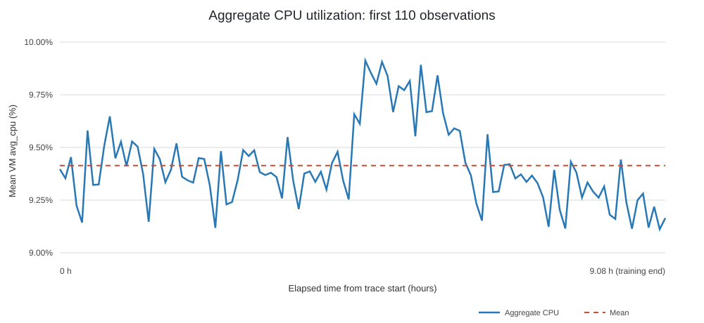
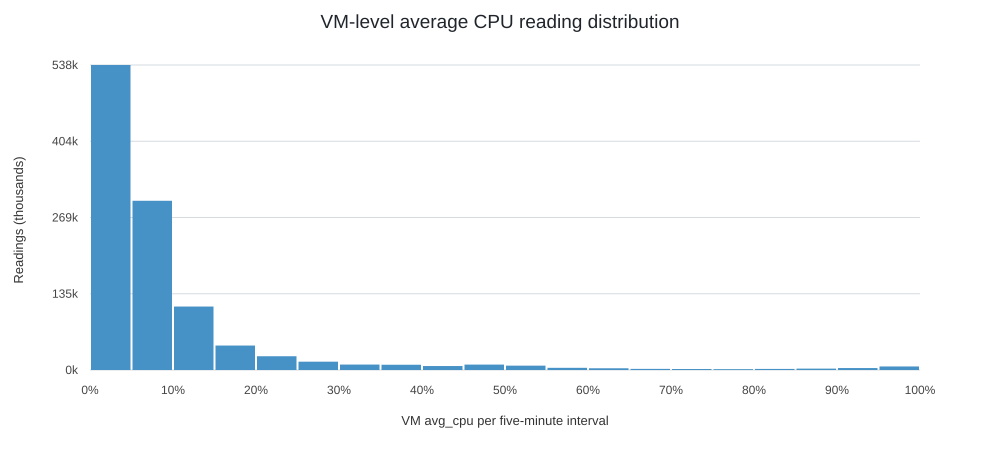
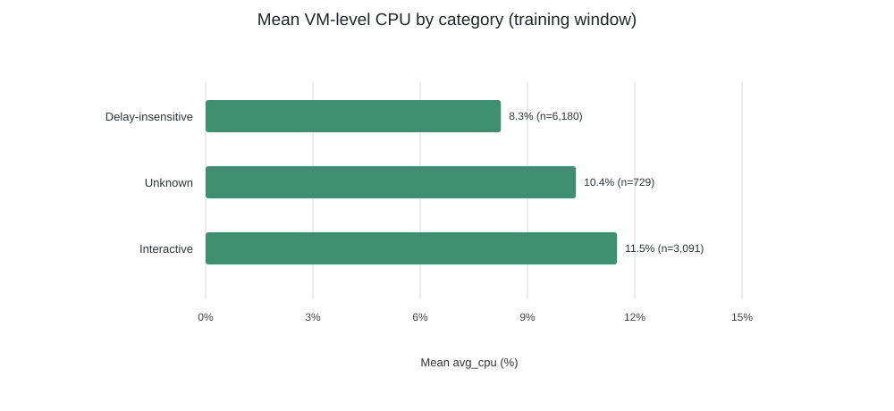

# Cloud Workload Forecasting and Operational Analysis

**Submission report** · Fixed release: data-v1 · Forecast horizon: two hours

## Executive summary

This submission forecasts two aggregate targets from the curated Microsoft Azure Public Dataset V2 VM trace: the number of distinct VMs represented at each timestamp, and the mean of VM-level average CPU utilization readings. The release contains 1,340,000 readings from 10,000 VMs over 134 five-minute timestamps. Checksums verify; CPU and metadata fields have no missing values; VM/timestamp keys and timestamps are unique and regular; and all VM traces are complete.

The challenge split is chronological: the first 110 aggregate observations are used for model development, and the final 24 timestamps are the two-hour forecast horizon. Candidate selection uses only the first 110 observations with five expanding-window folds. Of persistence, training mean, and first-order autoregression (AR(1)), AR(1) achieved the lowest mean fold MAE: **0.1968 percentage points**, versus **0.2326** for persistence, a **15.4% reduction**. Mean fold RMSE was 0.2362 versus 0.2681 for persistence, an 11.9% reduction. These are validation results, **not** a measured score on the final holdout.

Aggregate CPU is smooth relative to the highly dispersed VM-level readings. The aggregate average can therefore conceal hot VMs. AR(1) wins on overall MAE but performs worse than persistence on the selected peak-period subset. The recommended use is a frequently refreshed planning signal with an error buffer and per-VM/per-segment tail monitoring—not an autonomous scaling controller.

## 1. Data understanding and preprocessing

### 1.1 Source and data quality

The fixed data-v1 release is described by [DATASET.md](../DATASET.md); provenance and curation are summarized in [DATA_RELEASE.md](../DATA_RELEASE.md) and [SOURCES.md](../SOURCES.md). The upstream source is [Microsoft Azure Public Dataset V2](https://github.com/Azure/AzurePublicDataset). The challenge release is a curated subset of the source, not synthetic data.

| Data-quality check | Observed result |
|---|---:|
| CPU reading rows | 1,340,000 |
| Distinct VM IDs | 10,000 |
| Distinct timestamps | 134 |
| Timestamp range | 0–39,900 seconds |
| Cadence | 300 seconds |
| Readings per VM | exactly 134 |
| Distinct VMs at each timestamp | 10,000 |
| Missing CPU values | 0 |
| Duplicate VM/timestamp pairs | 0 |
| Missing metadata values | 0 |
| Data-card/checksum entries verified | 3 of 3 |

The timestamps advance in exact five-minute steps. CPU and metadata VM populations match. The first and last timestamp values are 11 hours and 5 minutes apart; the 134 five-minute observation bins cover 11 hours and 10 minutes when counting the duration represented by each bin. These are findings about the supplied curated panel, not necessarily about production cloud activity.

### 1.2 Target construction and split

At each timestamp \(t\), the required targets are:

\[
\mathrm{active\_vm\_count}_t =
\left|\{\mathrm{vm\_id}\text{ with an observation at }t\}\right|
\]

\[
\mathrm{aggregate\_cpu\_utilization}_t =
\frac{1}{N_t}\sum_{i=1}^{N_t}\mathrm{avg\_cpu}_{i,t}
\]

The CPU target is the mean of VM-level average CPU percentages, not fleet-wide CPU capacity consumption. Each VM is counted once per timestamp. The pipeline checks required columns, empty frames, nulls, duplicate VM/timestamp keys, finite readings, and the [0,100] CPU range.

The first 110 target observations end at timestamp 32,700 seconds. The final 24 output timestamps are 33,000 through 39,900 seconds. Target statistics, segment comparisons, model validation, and figures use the first 110 points. The final 24 timestamps define the required forecast rows; their actual CPU target values are not used for fitting, model choice, tuning, or validation scoring. This report does not claim final-holdout accuracy.

## 2. Workload analysis

### 2.1 Aggregate time behavior

Across the first 110 observations, aggregate CPU has mean **9.414%**, standard deviation **0.194 percentage points**, minimum **9.112%**, and maximum **9.912%**. Its 5th–95th percentile range is 9.132%–9.829%, and the mean absolute five-minute change is 0.121 percentage points. Lag-1 autocorrelation is **0.667**; lag 6 is 0.477 and lag 12 is 0.367. Recent values contain useful short-horizon signal. Autocorrelation at lags 18 and 24 is near zero or slightly negative, so the short trace cannot establish daily or weekly recurrence.

The highest aggregate value in the training window occurs at source timestamp 16,500 seconds (4 hours 35 minutes from start); the minimum is at 32,400 seconds (9 hours from start). These are positions in one relative-time trace, not recurring clock-time patterns.

### 2.2 VM-level distribution and hotspots

Within the training window, the median VM-level avg_cpu reading is **5.12%**, the 95th percentile is **37.29%**, and the 99th percentile is **87.41%**. Approximately **1.56%** of VM readings are at least 70%, and **0.88%** are at least 90%. These fractions count five-minute VM readings, not distinct VMs or the amount of time each VM is saturated.

The long upper tail means an aggregate mean near 9.4% does not demonstrate that all VMs are lightly loaded. Aggregate-only monitoring can hide individual hotspots; per-VM and segment-level metrics are required for operational interpretation.

### 2.3 Segment-level differences

These comparisons use only readings from the first 110 timestamps. Interactive VMs have a higher mean reading (11.51%) than Delay-insensitive VMs (8.26%). Unknown-category VMs average 10.36%, and their reading-level P95 is highest at 52.50%. Category labels are inherited from the release and are not assigned new meanings here.

| VM category | VMs | Mean reading CPU | Reading-level P95 |
|---|---:|---:|---:|
| Delay-insensitive | 6,180 | 8.26% | 25.94% |
| Interactive | 3,091 | 11.51% | 49.15% |
| Unknown | 729 | 10.36% | 52.50% |

Resource-size buckets also differ. The 24-core bucket has mean CPU of 11.43% and P95 of 52.51%, but contains only 62 VMs. The dominant 2-core bucket contains 7,534 VMs with mean 9.76% and P95 39.21%. For memory, the 4-GB group has mean 11.46% and P95 58.77%, compared with 7.81% and 29.51% for the 32-GB group. These are descriptive associations and do not show that VM size causes CPU usage to differ.

### 2.4 VM lifetimes and limitations

The derived active_vm_count is **10,000 at every timestamp**. All selected VMs have complete 134-reading traces. Metadata has one unique creation-timestamp value and no VM deletion timestamp at or before the last observation. Thus, the released sample contains no observed VM arrivals or departures. Persistence on the VM-count target reflects the constant panel; it is not a model of churn. The short trace also limits claims about seasonality and generalization to other periods or environments.

## 3. Forecasting approach and validation

### 3.1 Candidates and metrics

Three simple aggregate-CPU candidates were evaluated:

- **Persistence:** repeat the last training value.
- **Training mean:** repeat the mean of the training history.
- **AR(1):** fit a linear relationship between a previous observation and its successor, then recursively produce each forecast step. With too little history, it falls back to the last value.

Selection uses mean fold MAE. RMSE, symmetric mean absolute percentage error (sMAPE), signed bias, peak-period MAE, and horizon buckets provide additional diagnostics. Since CPU utilization is measured as a percentage, MAE and RMSE are reported in percentage points. The sMAPE implementation floors its denominator to avoid division by zero.

### 3.2 Expanding-window validation

For the official 110-point training window, the first fold uses 36 training observations (three hours), then evaluates the next 24 observations (two hours). Origins advance by 12 points, giving zero-based origins **36, 48, 60, 72, and 84**. Every fold remains within the first 110 observations. Validation windows overlap by 12 points, so their errors are useful comparative evidence but are not independent replicates.

### 3.3 Results

| Model | Mean fold MAE ↓ | Mean fold RMSE ↓ | sMAPE ↓ | Signed bias | Peak MAE ↓ |
|---|---:|---:|---:|---:|---:|
| AR(1), selected | **0.1968** | **0.2362** | **2.075%** | -0.0191 pp | 0.3069 pp |
| Training mean | 0.2014 | 0.2409 | 2.124% | -0.0277 pp | 0.3235 pp |
| Persistence | 0.2326 | 0.2681 | 2.444% | +0.0768 pp | **0.2609 pp** |

Against persistence, AR(1) reduces mean fold MAE by **15.4%**, RMSE by **11.9%**, and sMAPE by **15.1%**. Its MAE gain over training mean is smaller, about 2.3%. Average signed bias is -0.019 percentage points, indicating slight under-forecasting under the definition prediction minus actual.

AR(1) error grows later in the horizon: mean fold MAE is 0.1379 percentage points for steps 1–6, 0.2025 for steps 7–12, 0.1969 for steps 13–18, and 0.2497 for steps 19–24. Refreshing the forecast as new telemetry arrives is preferable to treating a two-hour forecast as a fixed plan.

### 3.4 Peak errors and failure analysis

For each fold, peak observations are defined as actual validation values at or above the 75th percentile of that fold's training-only aggregate CPU values. The mean of the fold-specific thresholds is approximately **9.518%**. On these peak observations, AR(1) mean fold MAE is **0.3069 percentage points**, worse than persistence at **0.2609**. The best overall model is not the best peak-period model.

Across overlapping validation-window errors, AR(1) absolute-error P90 is approximately **0.418 percentage points**, P95 is **0.460**, and peak-subset P90 is **0.503**. These are empirical error quantiles from a short validation record, not prediction intervals or guarantees.

Risks include smoothing sudden spikes, lack of a long seasonal record, individual hotspots hidden by aggregation, and metric sensitivity to a small set of overlapping folds. Supporting tables are linked in [validation_metrics.csv](generated/validation_metrics.csv), [validation_by_horizon.csv](generated/validation_by_horizon.csv), and [segment_summary.csv](generated/segment_summary.csv).

## 4. Operational recommendation

Treat this forecast as a **short-horizon planning signal**, not a standalone autoscaling controller. Aggregate mean CPU does not describe individual-node saturation, memory pressure, queue depth, or service-level objectives.

For an initial pilot, refresh forecasts every five minutes and observe both AR(1) and the persistence baseline. An initial buffer of about **0.42 percentage points** (the validation absolute-error P90) is reasonable to test under typical conditions; for high-load observations, test about **0.50 percentage points**. These values are descriptive starting allowances from five overlapping folds, not calibrated prediction intervals or production thresholds. AR(1) should not be trusted alone on peaks because peak-period MAE is worse than persistence.

Use forecast plus a policy-approved safety margin at the relevant pool or segment. Monitor per-VM and per-segment P95/maximum utilization in parallel, particularly Interactive and Unknown workloads. Escalate for human review when the buffered forecast approaches an organization-defined capacity/SLO threshold or VM-level tail metrics rise despite a stable aggregate mean. This dataset does not justify a universal utilization threshold: operators must set it using actual infrastructure limits, SLOs, and the cost of over-provisioning versus under-provisioning.

More headroom reduces saturation risk but can waste capacity; less headroom improves utilization but raises the risk of delayed scaling or service degradation. Before automating, backtest the policy on a longer trace containing genuine VM churn, high-demand episodes, and observed scaling outcomes.

## 5. Reproducibility and conclusion

After downloading and extracting the fixed release into challenge_data, install the analysis dependency and reproduce the tables and figures with:

~~~powershell
python -m pip install -e ".[dev,analysis]"
python analysis/analyze_workload.py --data challenge_data --output-dir reports/generated --figure-dir reports/figures
python -m pytest -q
~~~

The required prediction command is:

~~~powershell
python -m cwfc.predict --data challenge_data --output predictions.csv
~~~

The analysis script verifies data checksums, checks trace structure, generates target and segment summaries, evaluates candidates only on the training window, and writes reproducible CSV/JSON tables and SVG figures. The release itself is downloaded separately in accordance with the submission contract.

**Conclusion.** AR(1) is a defensible low-complexity choice under the mean-fold-MAE selection rule and improves average rolling-validation error over persistence. The constant VM-count target, heterogeneous VM-level upper tail, short curated time span, and worse AR(1) performance on peaks are central limitations and should shape any operational use.

## References

- Assignment requirements and rubric: [ASSIGNMENT.md](../ASSIGNMENT.md).
- Target definitions and chronological holdout: [DATASET.md](../DATASET.md).
- Submission output and repository rules: [SUBMISSION.md](../SUBMISSION.md).
- Release provenance: [DATA_RELEASE.md](../DATA_RELEASE.md) and [SOURCES.md](../SOURCES.md).
- Upstream source: [Microsoft Azure Public Dataset](https://github.com/Azure/AzurePublicDataset).
